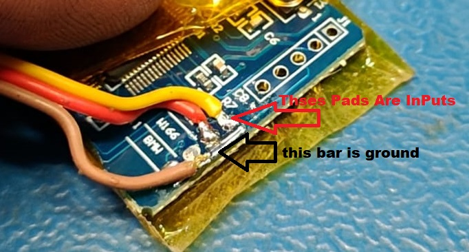
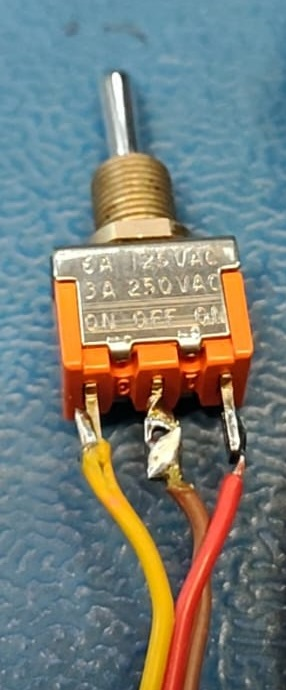

# Nissan_Leaf_80_Percent_SOC_Switch_Can_Bridge

Firmware for the STM32F105 **2-port CAN-bridge** used in Nissan LEAF battery upgrades. It adds a
hardware switch that sets where AC charging stops: **100 %, 80 % or 60 %**.

This is a modified version of the CANBRIDGE-2port firmware from
**[dalathegreat/Nissan-LEAF-Battery-Upgrade](https://github.com/dalathegreat/Nissan-LEAF-Battery-Upgrade)**,
licensed GPL-3.0. All credit for the original bridge firmware, flasher and install guide goes to
that project. Read the upstream README for the hardware, install and wiring of the bridge itself.

## Video

[](https://youtu.be/3inqoUJ95z8)

▶ <https://youtu.be/3inqoUJ95z8>

---

## Why charge to 80 %?

- **Charging to 100 % is fine if you'll be driving soon afterwards.** What wears a lithium-ion
  battery faster is **sitting at a high state of charge** for long periods, e.g. charged to
  100 % and then parked for days.
- **Most people don't use the full 100 %-to-0 % range day to day.** If your normal driving fits
  comfortably in 80 %, charging to 80 % and leaving the battery there is an easy way to help it
  last longer.
- **Switch to 100 % before a long trip** when you need the extra range. Flip the switch back
  afterwards.

> **⚠️ DO charge to 100 % at least once a month.** A full charge lets the battery management
> system (BMS) balance the cells and recalibrate its state-of-charge and capacity estimates.
> Without it, the SOC/range readings can drift and the cells can drift out of balance. Put the
> switch in the centre (100 %) position, let it charge fully, and ideally leave it plugged in a
> while after it reports full so balancing can finish.

---

## Use your existing battery-upgrade CAN-bridge

This runs on **the same 2-port CAN-bridge board that is already used for LEAF battery upgrades**.
You don't need new bridge hardware. The bridge does the same job as before. This firmware just
adds a switch on the board's spare input pads to choose the charge limit:

1. Solder the switch to the board's input pads (see [Switch wiring](#switch-wiring)).
2. Flash this firmware with BridgeFlasher, in place of the upstream firmware (see [Flashing](#flashing)).
3. Install the bridge exactly as the upstream guide describes.

With no switch fitted, or the switch in the centre, the bridge behaves like the original firmware
and charges to 100 %.

### How this compares with the upstream firmware

Be clear about what you're replacing:

- **Base version:** this firmware is built on upstream commit
  [`4697560`](https://github.com/dalathegreat/Nissan-LEAF-Battery-Upgrade/commit/4697560c93)
  (2024-06-06). Apart from the changes listed below, `can.c`, `main.c`, `gpio.c` and the CAN
  bridge logic are the same as that commit.
- **Added by this project:** the charge-limit switch (rev 0002), plus comments only (rev 0003/0004).
- **Also added in this base (not in upstream):** a `0x1C2` message, the ZE1 "second processor"
  counter, cycling 0x50–0x5F. It's sent on both CAN buses each time a `0x1F2` message is received.
  It was already in the firmware this project started from, and it's included in the tested build.
- **Not included:** three later upstream commits (June 2024 and May 2026), all aimed at **2011–2013
  ZE0** cars. They add `0x390`/`0x393` PDM messages towards the battery (P3196) and a
  no-charging workaround for the ZE0 instrument-cluster fix. If you have a ZE0 car and rely on
  those fixes, compare with the current upstream before switching.

---

## What changed

The full change history is at the top of [`source/Src/can-bridge-firmware.c`](source/Src/can-bridge-firmware.c).

| Rev  | Change |
|------|--------|
| 0001 | Firmware as received (baseline, see [above](#how-this-compares-with-the-upstream-firmware)) |
| 0002 | **Selectable AC charge limit** read from input pins Inp1 and Inp2 |
| 0003 | Comments only: PCB silkscreen labels for the input pins |
| 0004 | Comments only: confirmed working on hardware; explained the board lock (see [Flashing](#flashing)) |

### How the charge limit works

- The bridge reads the battery's **real SOC** from CAN message `0x55B`, in 0.1 % steps.
- When the SOC reaches the selected limit **during an AC charge** (`0x1F2` charge request =
  "Normal Charge"), the bridge changes the battery's `0x1DB` message to the car. It sets
  **`LB_Full_CHARGE_flag` = 1** and **`LB_Failsafe_Status` = 2 ("Charging Mode Stop Request")**,
  then recalculates the CRC.
- The car ends the charge. **It won't charge again until the charge cable is unplugged and
  plugged back in.**
- **100 % (switch in the centre):** the bridge does nothing extra. The battery's own data goes
  to the car as in the original firmware, and the battery decides when it's full.
- **Only AC charging is affected.** Driving, idle and DC quick charging (CHAdeMO) are never
  touched. The QC station manages its own stop.
- **No stop/start cycling:** once the limit is hit it stays latched. The latch clears when SOC
  falls 3 % below the setpoint (e.g. below 77 % on the 80 % setting), when the switch goes back
  to the centre (100 %), or when the car wakes up again.
- **Lowest limit wins.** The original firmware's support for the car's own 80 % charge setting
  (`0x1F2` `TargetCharge_SOC`) is kept. If both are active, whichever limit is lower stops the
  charge. The switch can always lower the limit, but it can't force 100 % if the car itself
  asks for 80 %.
- **The dash may show a slightly higher %** when charging stops. The limit uses the battery's
  real SOC, not the rescaled dash SOC. On an AZE0 car the dash maps real 5–95 % to 0–100 %, so
  a real 80 % shows as about 83 %.
- The switch is read once a second, so you can change it while the car is on. No reboot needed.

---

## Switch wiring

Use a **3-position ON-OFF-ON (SPDT, centre off) toggle switch**:

| Switch position | Connects | Inp1 (unmarked) | Inp2 (W222) | Charge stops at |
|---|---|---|---|---|
| **Up**     | Inp1 → GND  | **Low** | High | **80 %** |
| **Centre** | nothing     | High | High | **100 %** (normal) |
| **Down**   | Inp2 → GND  | High | **Low** | **60 %** |

```
   3-position ON-OFF-ON switch (3 terminals)

   Inp1 (unmarked) ──── outer terminal A  -> lever UP    = 80 %
   board GND ────────── centre terminal      (common)
   Inp2 (W222) ──────── outer terminal B  -> lever DOWN  = 60 %

   lever CENTRE = nothing connected = 100 %
```

### Only want 80 %? Use a simple on/off switch

If you only need the 80 % limit, you don't need the 3-position switch. Use a plain **2-terminal
ON-OFF (SPST) toggle switch** and wire just one input:

```
   Simple ON-OFF switch (2 terminals)

   Inp1 (unmarked) ──── terminal 1
   board GND ────────── terminal 2

   switch ON  = Inp1 grounded = stop at 80 %
   switch OFF = open          = 100 % (normal)
```

- Leave **Inp2 (W222) unconnected**. Its internal pull-up keeps it inactive, so 60 % is never
  selected.
- To get only the 60 % limit instead, wire the switch to **Inp2 (W222)** and leave Inp1 open.
- The firmware is the same either way. Nothing needs to be rebuilt.

### Solder points on the board



The input pads sit in a row beside the silkscreen labels (red arrow). The **ground bar** runs
along next to them (black arrow). In the photo the **brown** wire goes to the ground bar, and
the **yellow** and **red** wires go to the two input pads.

### The switch



The **brown (ground) wire goes to the centre terminal**. The yellow and red wires (the two
inputs) go to the outer terminals.

- On most toggle switches, pushing the lever **up** connects the **bottom** outer terminal.
  Check with a meter and swap the two outer wires if up and down are the wrong way round.
- The inputs have internal pull-ups, so no resistors are needed. Open = high = inactive.
  Grounded = low = active.
- If both inputs are somehow grounded at once, the bridge uses 60 % (the lower limit wins).
- Leaving the switch out entirely (both inputs open) = 100 % = original behaviour.

---

## Input pins and PCB labels

The board's silkscreen labels don't match the firmware names. This table maps them:

| Board label  | Firmware name | MCU pin | Use in this firmware |
|--------------|---------------|---------|----------------------|
| *(unmarked)* | Inp1          | PC12    | Pull to GND = **80 %** charge stop |
| **W222**     | Inp2          | PC11    | Pull to GND = **60 %** charge stop |
| **W116**     | Inp3          | PC10    | Not used (input, pulled up) |
| **BMW**      | Inp4          | PA15    | Not used (input, pulled up) |

All four pins are configured as inputs with internal pull-ups (`source/Src/gpio.c`). Nothing
needs to be connected to Inp3 or Inp4.

---

## Changing the 80 % / 60 % setpoints

To stop at different percentages, edit these lines near the top of
[`source/Src/can-bridge-firmware.c`](source/Src/can-bridge-firmware.c) (about line 105):

```c
#define CHARGE_LIMIT_100_PPTT       1000    // no limit, bridge does not interfere
#define CHARGE_LIMIT_80_PPTT        800     // Input 1 pulled low
#define CHARGE_LIMIT_60_PPTT        600     // Input 2 pulled low
#define CHARGE_LIMIT_HYST_PPTT      30      // latch releases 3.0% below the setpoint
```

- Values are in **tenths of a percent**: `800` = 80.0 %, `750` = 75.0 %, `900` = 90.0 %.
- **Switch UP (Inp1)** uses `CHARGE_LIMIT_80_PPTT`. **Switch DOWN (Inp2)** uses
  `CHARGE_LIMIT_60_PPTT`. You only need to change the number; the name stays the same even if
  the value isn't 80 or 60 any more.
- Keep both values **below 1000**. Leave `CHARGE_LIMIT_100_PPTT` at `1000`, because that's what
  makes the centre position mean "don't interfere".
- `CHARGE_LIMIT_HYST_PPTT` sets how far SOC must drop below the setpoint before the latch
  releases. `30` = 3.0 %.
- If both inputs are grounded, the Inp2 value is used.
- These values are compared with the battery's **real** SOC, not the dash SOC (see above).

Then rebuild (see [Building from source](#building-from-source)) and flash the new `.srec` with
BridgeFlasher.

---

## Flashing

A ready-built file is in [`source/output/canbridgeWith_60_80_Switch_Input.srec`](source/output/)
(the default 80 % / 60 % setpoints). It's the build tested on hardware. Later revisions only
changed comments, so the code is the same.

**Flash it with [`source/BridgeFlasher.exe`](source/), not with ST-Link directly.**

- BridgeFlasher is **dalathegreat's tool**, included here for convenience. It's byte-for-byte
  identical to the copy in the
  [upstream repo](https://github.com/dalathegreat/Nissan-LEAF-Battery-Upgrade) (SHA-256
  `29ba6950f71ce5d1e496cb6b8d102bf2c70c364bc484c8e2e1ddc476e2fedb1a`).
- Keep `BridgeFlasher.exe.config` in the same folder as the `.exe`.
- It needs the **.NET Framework 4.8** and the **CLI** version of the ST-Link tool
  (`ST-LINK_CLI.exe`, part of STM32 ST-LINK Utility).
- Follow the upstream README for the ST-Link setup and wiring.

**To flash:**
1. Run `BridgeFlasher.exe`.
2. Select `ST-LINK_CLI.exe`.
3. Select the `.srec` file.
4. Press **Flash!**

Windows may warn about an unknown publisher the first time you run it.

**Why it has to be BridgeFlasher (board lock):** the firmware checks the STM32's factory unique
chip ID at boot and keeps resetting if it doesn't match the 12 bytes stored in the firmware
(`au8_lock` in `source/Src/main.c`). Those 12 bytes in the source and the `.srec` are only a
**placeholder**. BridgeFlasher does three things:
1. Removes read protection.
2. Reads the target chip's unique ID from address `0x1FFFF7E8`.
3. Replaces the placeholder in the `.srec` with that ID, then flashes it.

So each board ends up with firmware matched to its own chip, and one `.srec` works on any number
of boards. **Don't change the `au8_lock` placeholder bytes**, or BridgeFlasher won't find them
("Failed to find replacement bytes"). If you flash the `.srec` straight from ST-Link, the bridge
will reset forever on boot.

---

## Building from source

- **IDE:** Keil µVision 5 (MDK-ARM). Open `source/MDK-ARM/jcan.uvprojx`.
- **Target:** STM32F105RC, STM32CubeF1 HAL (included under `source/Drivers/`, ST's own licences).
- A post-build step (`fromelf`) writes `source/output/canbridge.srec`. Flash that with
  BridgeFlasher as described above.

---

## Licence and disclaimer

GPL-3.0. See [`LICENSE`](LICENSE). This is a modified version of
[dalathegreat/Nissan-LEAF-Battery-Upgrade](https://github.com/dalathegreat/Nissan-LEAF-Battery-Upgrade).
The STM32 HAL/CMSIS files under `source/Drivers/` are © STMicroelectronics / Arm under their own
licences (included in those folders). `source/BridgeFlasher.exe` is redistributed unchanged
from the upstream project.

This modifies high-voltage battery messages on a vehicle CAN bus. It comes with **no warranty**,
and you use it at your own risk.
